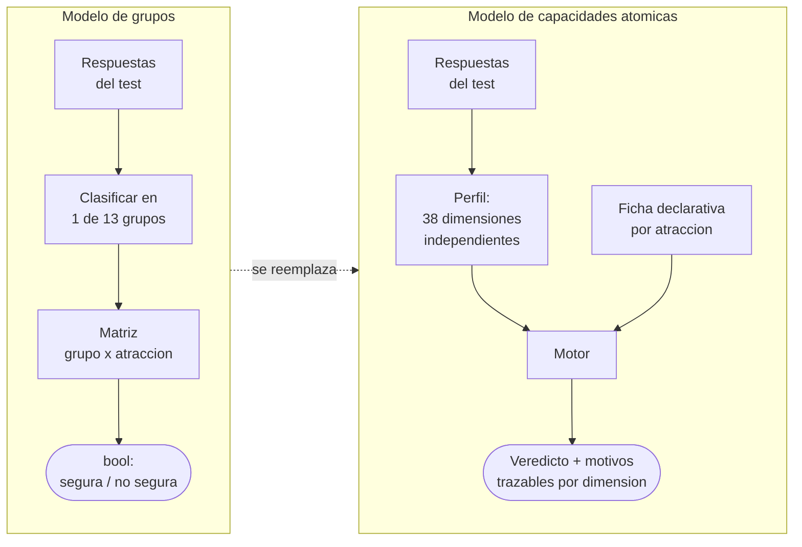
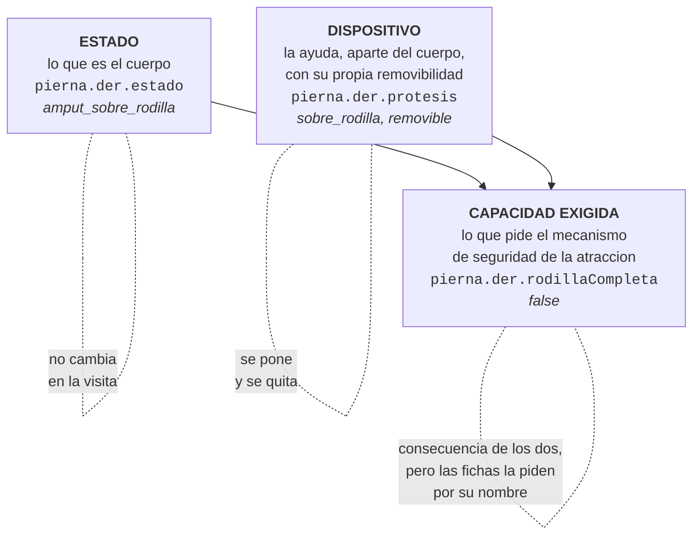
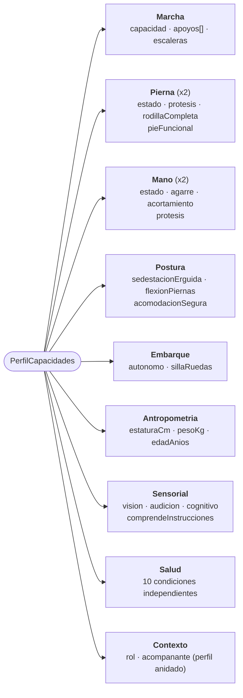
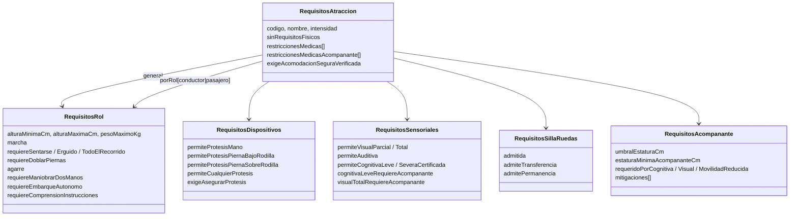
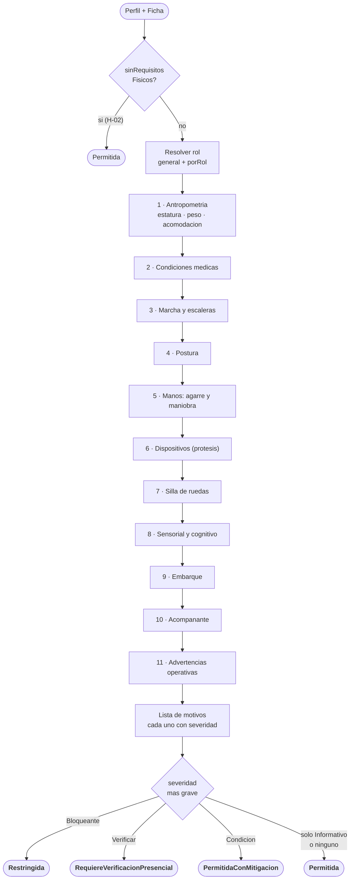
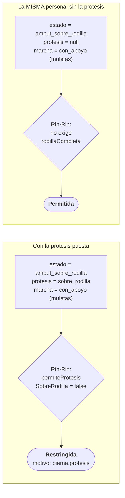
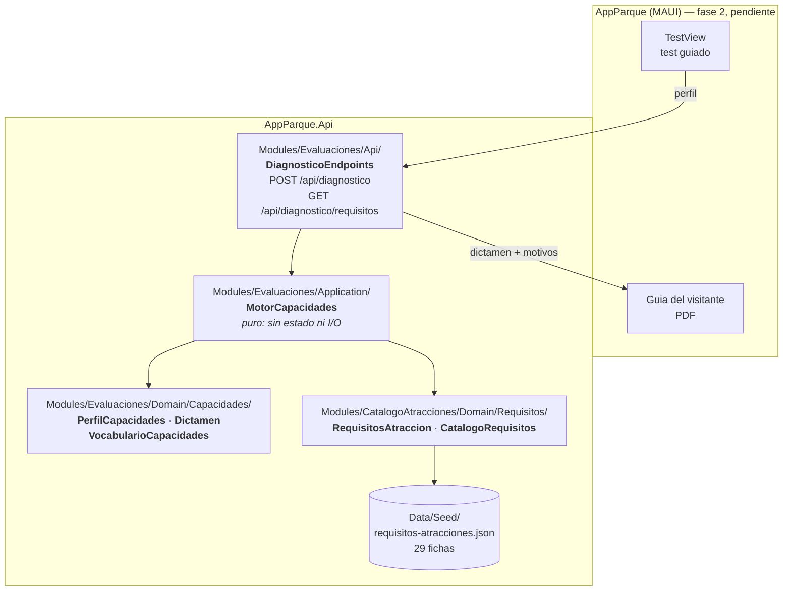
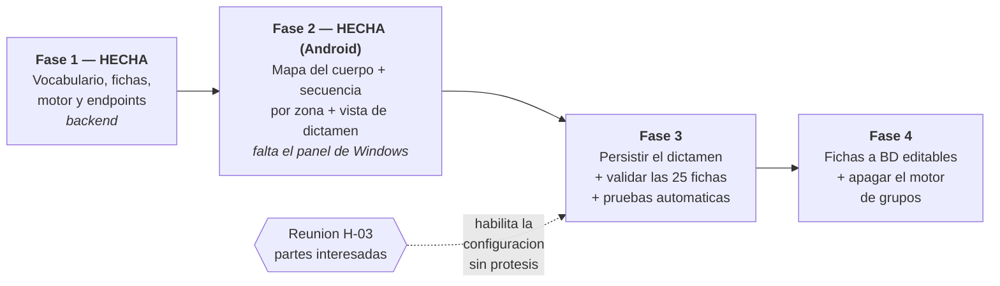

# Estrategia de evaluación por capacidades atómicas

**Estado:** implementada en backend (fase 1 de 4) · **Fecha:** 2026-10-04
**Reemplaza:** la sección 5 (motor de reglas por grupos) de [Requisitos-App-Evaluacion-Accesibilidad.md](./Requisitos-App-Evaluacion-Accesibilidad.md)
**Fuente de datos:** las 25 fichas de seguridad por atracción (`chunks_parque_cafe`) + 4 eventos culturales confirmados por el negocio

---

## 1. El problema que cierra este documento

El modelo anterior clasificaba al visitante en uno de 13 **grupos** (`grupo_1`, `grupo_5_2`, `protesis_mano`…) y cruzaba ese código contra una matriz de atracciones. Un grupo es una fotografía: describe a una persona completa de una sola vez y no se puede descomponer.

Eso se rompe con un caso real y corriente:

> Un visitante con amputación transfemoral y prótesis por encima de la rodilla, que camina con muletas. **La prótesis se la puede quitar.** Rin-Rin prohíbe la prótesis por encima de la rodilla, pero no exige rodilla completa.

Con grupos hay que elegir un solo código para esa persona, y cualquiera que se elija es falso la mitad del tiempo: con la prótesis puesta es un visitante distinto que sin ella. El sistema no podía representar a una persona en dos configuraciones, ni decir *por qué* una atracción quedaba fuera, ni distinguir «no puede» de «falta preguntarle algo».

El cambio de fondo es dejar de preguntar **a qué grupo pertenece** y empezar a preguntar **qué puede hacer su cuerpo, qué dispositivo lleva puesto y qué exige el mecanismo de seguridad de cada atracción** — tres cosas separadas.

| | Modelo de grupos | Capacidades atómicas |
|---|---|---|
| Unidad de descripción | 1 grupo por persona | 38 dimensiones independientes |
| Persona con ayuda removible | imposible de representar | dos configuraciones del mismo perfil |
| Resultado | `bool` | 4 veredictos + motivos |
| Dato sin responder | permiso silencioso | `RequiereVerificacionPresencial` |
| Agregar una atracción | tocar la matriz completa | agregar una ficha |
| Agregar una pregunta | redefinir los grupos | agregar una dimensión |

---

## 2. La regla que ordena todo el vocabulario

Cada parte del cuerpo se describe en **tres ejes que nunca se mezclan**. Confundirlos es lo que producía las contradicciones del modelo viejo.

De aquí sale la regla operativa más importante del motor:

> **Las fichas restringen el dispositivo, no el estado del cuerpo.**
> Por eso hay atracciones que prohíben la prótesis y aceptan la amputación.

---

## 3. El vocabulario: 9 dominios, 38 dimensiones

Tres decisiones del vocabulario que conviene justificar:

- **`Lateralidad<T>`** evita duplicar 17 campos «izq»/«der». Las reglas preguntan por conteos («al menos una», «ambas»), nunca por un lado concreto.
- **`Respuesta.NoDeterminado = 0`** es el valor por defecto a propósito. Sin dato **no es «no»**: no permite ni restringe, obliga a preguntar.
- **`acompanante` apunta a un perfil completo**, no a una casilla. Los dos carruseles exigen que el acompañante adulto no esté embarazado: es un segundo sujeto a evaluar.

---

## 4. Las fichas de atracción son datos, no código

H-08 dejó claro que **el sistema de seguridad depende de cada atracción y cambia**. Por eso los requisitos viven en un archivo declarativo y no en ramas de `if`: `AppParque.Api/Data/Seed/requisitos-atracciones.json`, una entrada por ficha.

`porRol` se **superpone** sobre `general`: Karts Dobles y Carros Chocones declaran solo lo que cambia entre conductor y pasajero. Si la atracción distingue rol y el test no lo preguntó, el motor asume pasajero (el menos exigente) y lo deja marcado.

**Regla de transcripción:** si un campo no aparece en la ficha del parque, no aparece en el JSON y vale el valor por defecto del modelo. Nunca se inventa un requisito que la ficha no escribió.

---

## 5. Cómo decide el motor

`MotorCapacidades` es **puro**: sin estado, sin base de datos, sin I/O. Eso es lo que permite validarlo atracción por atracción con operaciones.

Ninguna regla corta la evaluación: **todas corren siempre** y aportan sus motivos. Así el personal ve las tres razones por las que una atracción quedó fuera, no solo la primera.

### Las cuatro severidades

| Severidad | Qué significa | Efecto en el veredicto |
|---|---|---|
| `Bloqueante` | Incumple un requisito de la ficha | `Restringida` |
| `Verificar` | Falta un dato, o la ficha delega en el juicio del operador | `RequiereVerificacionPresencial` |
| `Condicion` | Se puede, aplicando una mitigación concreta | `PermitidaConMitigacion` |
| `Informativo` | No decide nada; sale impreso en la guía del visitante | ninguno |

El veredicto intermedio es la ganancia funcional más grande del cambio: antes el sistema tenía que elegir entre un «sí» falso y un «no» falso cada vez que faltaba un dato.

### El caso que originó todo, resuelto

Verificado contra el motor: con prótesis, Rin-Rin devuelve `Restringida` con el motivo `pierna.protesis`; sin prótesis, el mismo perfil devuelve `Permitida`. El estado del cuerpo no cambió — cambió el dispositivo, que es lo que la ficha restringe.

---

## 6. Los once huecos, cerrados

| # | Hueco | Resolución | Dónde quedó |
|---|---|---|---|
| **H-01** | Montaña Rusa sin requisitos escritos | **Cerrado — fuera de alcance.** La atracción ya no existe en el parque. | no está en el catálogo |
| **H-02** | Museo, Sendero, Show y Arte del Café sin requisitos | **Cerrado.** Son eventos culturales sin riesgo por su uso. | `sinRequisitosFisicos: true`, 4 entradas |
| **H-03** | Removibilidad de la prótesis no se registra | **PENDIENTE de reunión con las partes interesadas.** El campo se captura y se almacena; el motor **no** calcula todavía el veredicto «sin la prótesis», solo emite una nota informativa. Ver §7. | `Protesis.Removible`, motivo `protesis_removible_h03` |
| **H-04** | Caminador y silla de ruedas no existen como apoyo | **Cerrado.** Siguen siendo apoyos. Lo que se evalúa son capacidades y condiciones: **ninguna regla pregunta por el tipo de ayuda**, solo por `marcha.capacidad`. Los apoyos se registran como contexto operativo. | `Marcha.Apoyos` (informativo) |
| **H-05** | Nadie mide la comprensión de instrucciones | **Cerrado — se agrega como pregunta propia.** Dimensión independiente de «discapacidad cognitiva». La exigen las 6 atracciones cuya ficha no admite cognitiva leve. | `sensorial.comprendeInstrucciones` |
| **H-06** | «Maniobrar» solo en tres atracciones | **Cerrado — no es omisión.** En caballos y karts el visitante queda más expuesto; en botes y carros chocones el ambiente es controlado y basta sujetarse. | `requiereManiobrarDosManos` en 3 fichas |
| **H-07** | Un solo límite de peso | **Cerrado.** Solo Paseo a Caballo (100 kg). Peso y estatura se piden siempre en el formulario para descartar automáticamente. | `pesoMaximoKg`, `estaturaCm` |
| **H-08** | Rin-Rin ambiguo con amputación sobre rodilla sin prótesis | **Cerrado con las fichas: permitida.** El sistema de seguridad depende de cada atracción, y la ficha restringe el **dispositivo**, no el muñón. De aquí sale la separación estado / dispositivo / capacidad. | `RequisitosDispositivos` separado |
| **H-09** | El agarre dependería de la marcha | **Cerrado — no es regla cruzada.** Las fichas lo declaran como umbral fijo por atracción (`una_mano` / `ambas_manos`). | `RequisitosRol.Agarre` |
| **H-10** | Las mitigaciones solo vivían en la matriz | **Cerrado.** Catálogo completo tomado de las advertencias operativas de las fichas: acompañante adulto, misma fila, silla del centro, silla interna, conductor acompañante, asistencia de embarque. **El chaleco no aparece en ninguna ficha** y se descarta. | `CodigosMitigacion` |
| **H-11** | No había umbral niño/adulto | **Cerrado — es estatura, no edad**, y distinta por atracción: 110, 120, 130, 140 o 150 cm. El acompañante válido es adulto **o** persona por encima de la estatura mínima que fije la ficha. | `umbralEstaturaCm` por ficha |

### Hallazgos nuevos de las fichas, que el artefacto de vocabulario no tenía

1. **Estatura mínima y máxima en casi todas las atracciones** — el vocabulario solo tenía peso. Es la causa más frecuente de rechazo en fila.
2. **Dos condiciones de salud nuevas:** `antecedentes convulsivos` y `bajo cuidado médico`. Hay que agregarlas al test.
3. **`mareo/vértigo` y `miedo a las alturas` son restricciones distintas** — iban fusionadas en una sola pregunta. Rueda Panorámica las lista separadas.
4. **Paseo a Caballo es la única que no admite discapacidad auditiva** (el jinete debe oír las indicaciones).
5. **Barón Rojo, Minichocones y Tren del Café admiten discapacidad cognitiva severa certificada**; el resto no.

---

## 7. H-03: qué llevar a la reunión

Es el único hueco que queda abierto, y queda abierto a propósito: la decisión no es técnica.

**La pregunta para las partes interesadas:** ¿se acepta que un visitante use una atracción **sin** su prótesis, cuando con ella queda restringido?

**Lo que ya está listo si la respuesta es sí:**

- El campo `Protesis.Removible` ya se captura y se almacena.
- El motor ya detecta el caso y emite el motivo `protesis_removible_h03`, visible para el personal.
- Habilitarlo es generar la configuración alternativa del perfil (quitar las prótesis removibles) y reevaluar. El motor es puro, así que evaluarlo dos veces no tiene costo ni efectos secundarios.

**Lo que hay que decidir en la reunión, no en el código:**

| Punto | Por qué importa |
|---|---|
| ¿Se autoriza el uso sin prótesis? | Sin autorización explícita, el sistema no debe sugerirlo |
| ¿Quién custodia la prótesis durante el recorrido? | Hoy no hay procedimiento ni responsable |
| ¿Quién autoriza, el enfermero o el operador de la atracción? | Define si el veredicto es automático o `RequiereVerificacionPresencial` |
| ¿Cambia la capacidad de marcha al quitársela? | Un perfil puede caminar con prótesis y no sin ella — hay que **volver a preguntar**, no deducir |
| ¿Queda registrado en el PDF del visitante? | Trazabilidad y responsabilidad legal |

Mientras no haya decisión, el comportamiento es el conservador: la atracción queda `Restringida` y la nota informativa le dice al personal que el caso existe.

---

## 8. Dónde vive cada cosa

El catálogo se lee **una vez al arrancar** (`AddSingleton`). Vive en un archivo y no en la base de datos por ahora a propósito: mientras operaciones valida las 25 fichas, conviene que cada corrección sea un diff revisable en git y no un `UPDATE`. Pasarlo a una columna `jsonb` de `Atraccion` no cambia nada del motor — solo de dónde sale el diccionario.

### Convivencia con el motor viejo

El motor de grupos (`MotorReglas` + `PreseleccionService`) **sigue en pie y sigue sirviendo** `/api/evaluaciones`, el historial y el PDF. El nuevo cuelga de `/api/diagnostico`. El corte se hace cuando las 25 fichas estén validadas, no antes: hasta entonces hay dos motores corriendo y se pueden comparar contra los mismos casos.

---

## 9. Casos de validación

Verificados contra la implementación. Son los casos que hay que repasar con operaciones, y el guion para convertirlos en pruebas automáticas (fase 3).

| # | Perfil | Resultado esperado | Qué demuestra |
|---|---|---|---|
| 1 | Adulto sin condiciones, 170 cm / 70 kg | 24 permitidas · 5 restringidas (todas por estatura máxima) | la línea base no restringe de más |
| 2 | Amputación transfemoral **con** prótesis removible, camina con muletas | Rin-Rin y Cumbre `Restringida` · Ciclón `Permitida` | el eje del dispositivo decide, no el del cuerpo |
| 3 | **La misma persona sin la prótesis** | Rin-Rin, Cumbre y Ciclón `Permitida` | H-08 resuelto; el caso que el modelo de grupos no podía representar |
| 4 | Comprensión de instrucciones sin responder | Krater y Telesillas `RequiereVerificacionPresencial` · Yippe `Permitida` | H-05; sin dato no es permiso |
| 5 | Niño de 115 cm, sin acompañante | Carrusel Cafeteritos `Permitida` (umbral 110) · Rin-Rin `Verificar` (umbral 120) · Krater `Restringida` (mínimo 130) | H-11; el umbral es por atracción |
| 6 | Niño de 105 cm con acompañante adulta embarazada | Carrusel `Restringida` por el **acompañante** | el acompañante es un segundo perfil |
| 7 | Silla de ruedas, no se transfiere | Teleférico Plaza y Tren `Permitida` · Teleférico Bambusario `Restringida` | las tres formas de modelar la silla |
| 8 | Una sola mano funcional, 155 cm | Karts Dobles `Permitida` como pasajero, `Restringida` como conductor · Botes Chocones `Permitida` | H-06 y los requisitos por rol |
| 9 | Perfil completamente vacío | 25 `RequiereVerificacionPresencial` · 4 `Permitida` (los culturales) | nada se permite por omisión |
| 10 | 105 kg | Paseo a Caballo `Restringida` · Krater `Permitida` | H-07 |

---

## 10. Hoja de ruta

### Fase 2, lo que quedó construido (Android)

El flujo móvil son **tres pantallas completas**, no un panel partido: en un teléfono el mapa y el
test no caben juntos sin que ninguno de los dos sea usable.

| Archivo | Qué es |
|---|---|
| `Features/EvaluacionAccesibilidad/CatalogoZonas.cs` | las 10 zonas y sus preguntas, declarativas |
| `Features/EvaluacionAccesibilidad/PerfilBuilder.cs` | zonas → dimensiones del vocabulario |
| `MapaCapacidadesView` + `ViewModel` | pantalla 1: el mapa del cuerpo como índice |
| `ZonaPuertaView` | pantalla 2: «sin novedad» o «evaluar» |
| `ZonaSecuenciaView` + `ViewModel` | pantalla 3: una pregunta a la vez, y vuelta al mapa |
| `Features/Dictamen/DictamenView` + `ViewModel` | el resultado con veredictos y motivos |
| `Shared/Models/PerfilCapacidadesDto.cs`, `DiagnosticoResponseDto.cs` | el contrato con la API |

**«Sin novedad» escribe valores, no los deja en blanco.** Es la decisión de diseño que sostiene todo
el atajo: marcar una zona pone sus dimensiones en «normal», mientras que dejarlas vacías manda
`NoDeterminado` y la atracción sale «por verificar». La zona **Medidas** es la excepción y no admite
el atajo: no existe una estatura normal por omisión, así que marcarla inventaría el dato.

### Lo que falta antes de usarlo en el parque

1. **El dictamen no se persiste.** `/api/diagnostico` es sin estado, así que el flujo nuevo **no deja
   registro en el historial** ni alimenta el PDF — eso sigue colgando de `/api/evaluaciones` y el
   motor de grupos. Es lo primero de la fase 3: un endpoint que guarde el dictamen con sus motivos.
2. **Ajuste manual (RF-06).** La vista de dictamen es de solo lectura; el personal todavía no puede
   incluir o excluir una atracción a mano.
3. **El panel de Windows**, con mapa y test a la vez.
4. **Android está deshabilitado en el `.csproj`** (`TargetFrameworks` vacío, falta el SDK). El código
   del flujo es neutro de plataforma y compila, pero no se ha ejecutado en un dispositivo.

### Dos defectos que destapó la integración

- **Los nulos rompían el contrato.** Los enums del backend no son nullable, así que un `"campo": null`
  hacía fallar la deserialización del perfil entero. Corregido en `ApiClient.JsonOptions` con
  `DefaultIgnoreCondition = WhenWritingNull`: lo que no se pregunta no se envía, y el backend lo lee
  como `NoDeterminado`.
- **El motor confundía «no se preguntó» con «viene solo».** `RevisarAcompanante` devolvía «verificar
  en sitio» cuando el enfermero ya había respondido que el visitante no trae acompañante. Ahora son
  dos motivos distintos: sin dato es `Verificar`, y venir solo a una atracción que exige acompañante
  es `Bloqueante`.

**Fase 2 — preguntas que hay que agregar al test guiado** (todas salen de los hallazgos de §6):

1. Estatura y peso (hoy la estatura es opcional y el peso no se pregunta) — H-07, H-11
2. Comprensión de instrucciones de seguridad — H-05
3. Antecedentes convulsivos · estar bajo cuidado médico — hallazgos 2
4. Separar «mareo o vértigo» de «miedo a las alturas» — hallazgo 3
5. Rol previsto (conductor / pasajero) en las atracciones que lo distinguen
6. Removibilidad de la prótesis — se **captura** aunque no se **use** hasta la reunión H-03

**Fase 3 — cómo validar con operaciones:** una ficha por sesión, con `GET /api/diagnostico/requisitos/{codigo}` al lado del documento original del parque. Los 10 casos de §9 se corren contra cada cambio.
